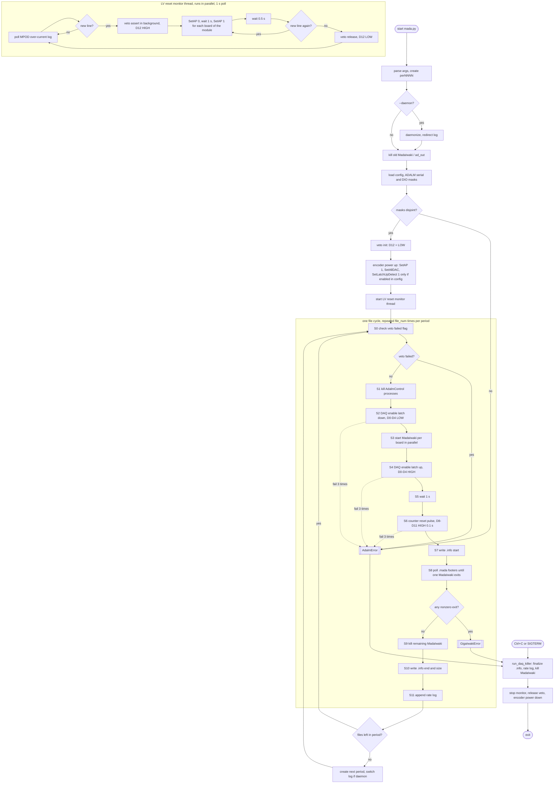

# MADA DAQ ワークフロー (mada.py)

フローチャート化を前提に、手順・分岐・並列処理・異常系を構造化して記述する。
エントリポイントは `scripts/mada.py`。外部AIへは、このファイルをそのまま渡せば足りる。

## 1. 用語とアクター

| ID | 名称 | 実体 | 役割 |
|----|------|------|------|
| A1 | mada.py | scripts/mada.py | 全体を制御するメインプロセス (Python) |
| A2 | MadaIwaki | bin/MadaIwaki (基板ごとに1プロセス) | GigaIwakiボードからイベントを受信し .mada ファイルへ保存 |
| A3 | AdalmControl | bin/AdalmControl | ADALM2000 のデジタル出力(DIO)を制御。実行のたびに別プロセスとして起動し、出力状態は終了後も保持される |
| A4 | RegulatorAutoresetMonitor | mada.py 内のスレッド | MPOD の過電流ログを監視し、LVリセット(AP 0->1)を実行 |
| A5 | SoftwareVeto | scripts/mada_software_veto.py | LVリセット中に ADALM D12 をHIGHにし、外部スケーラーへ veto を通知 |
| A6 | GigaIwakiボード | GBKB-32..35 など (config の active=1) | ASICを持つ読み出しボード。RBCPで設定、データはMadaIwakiが取得 |
| A7 | スケーラー | 外部 Zybo Z7-10 | リアルタイム/ライブタイムを計測 (本リポジトリ外) |
| A8 | ADALM | 1台 (S/N は config の ADALM.MADALM_0) | 3役割を DIO マスクで共有 |

### ADALM の DIO 割り当て (config の `DIO_mask`、bit i = Di)

| 役割 | config キー | ピン | マスク | 向き先 | 動作 |
|------|-------------|------|--------|--------|------|
| DAQ enable | MADALM_0 | D0-D4 | 0x001F | ボード + スケーラー | HIGH の間が計測、立ち下がりでスケーラーがピリオド情報を更新 |
| counter reset | MADALM_1 | D8-D11 | 0x0F00 | ボード | 100 ms のHIGHパルス |
| software veto | MADALM_2 | D12 | 0x1000 | スケーラー | HIGH の間はライブタイムを積算しない (アクティブHIGH) |

3役割は同一ADALM・同一S/Nで、`DIO_mask` が重ならない必要がある。重複・未設定なら mada.py は起動時に停止する。

## 2. 全体構造

```text
main
 +- 引数解析, perNNNN 作成, (--daemon なら常駐化)
 +- run_daq
     +- 前処理: 過去プロセス停止, 設定読み込み, マスク検査
     +- veto 初期化 (D12=LOW)
     +- エンコーダ電源投入 (AP on, DAC/Vth/bias, ラッチアップ検出 on は設定で有効時のみ)
     +- 監視スレッド開始 (LVリセット + veto)
     +- 無限ループ: period (= file_num 個のファイル) を繰り返す
     |    +- ファイルごとの取得サイクル (3章)
     +- 終了処理 (6章)
```

## 3. ファイルごとの取得サイクル (`run_period` の1反復)

イベント数 `event_num` (既定 1000) のファイルを `file_num` (既定 512) 個作る。1ファイルが1サイクル。

| 手順 | 処理 | 備考 |
|------|------|------|
| S0 | veto の解除失敗フラグを確認 | 失敗していれば AdalmError で安全停止 (7章) |
| S1 | 残っている AdalmControl プロセスを停止 | `run_kill_adalms` |
| S2 | DAQ enable を latch down (D0-D4 を LOW) | スケーラーが直前ファイルのピリオド情報を更新 |
| S3 | 全アクティブ基板で MadaIwaki を並列起動 | `-n event_num -f perXXXX/<board>_<file>.mada -i <IP>` |
| S4 | DAQ enable を latch up (D0-D4 を HIGH) | ここから計測 |
| S5 | 1秒待つ (データのフラッシュ) | |
| S6 | counter reset パルス (D8-D11 を 0.1 秒 HIGH) | |
| S7 | 開始時刻を記録し、各基板の .info を作成 | `runinfo.start` を書く |
| S8 | MadaIwaki の終了を待つ (進捗表示) | 3.1 参照 |
| S9 | 残りの MadaIwaki を kill | 1台でも終了した時点で全台停止 |
| S10 | 終了時刻を記録し、.info に end と size を追記 | .mada が無い基板は size=0 と error を記録 |
| S11 | レートログ追記 | `~/rate/YYYYMMDD` にタブ区切り |

S2, S4, S6 は AdalmControl の実行で、いずれも失敗時は最大3回リトライし、全部失敗すると AdalmError (7章)。
S2 の失敗時は MadaIwaki 起動前、S4 の失敗時は起動後に停止することになる。

### 3.1 S8 の待機ループ

- 0.2 秒ごとに各 .mada の末尾を読み、フッター `uPIC` の数を数えてイベント数とする。
- TTY なら進捗を上書き表示。デーモン時は最終値のみ出力。
- 1台でも MadaIwaki が終了したらループを抜ける。
- 終了コードが非0の基板があれば GigaIwakiError を送出し、安全停止 (7章)。

### 3.2 period の切り替え

`file_num` 個のファイルを作り終えると、`new_period()` で次の perNNNN を作成する。
デーモン時は stdout/stderr のログファイルも新しい period に切り替える。

## 4. 起動時の前処理 (`run_daq`)

1. 引数を解析する。`-c` (config)、`-f` (file_num)、`-n` (event_num)、`-d` (デーモン)、`--calin IP ch` (キャリブレーション入力用に1基板に限定)。
2. 最初の period ディレクトリ `perNNNN` を作成する。デーモンならここでバックグラウンド化する。
3. `run_kill_modules`: 既存の MadaIwaki, ad_out, mada_daq_killer を停止する。
4. config を読み、ADALM の S/N と各 `DIO_mask` を取得する。
5. `check_adalm_masks`: 同一ADALMを共有する役割のマスクが重ならないことを検査する。違反なら AdalmError。
6. `veto.initialize`: D12 を LOW にする (浮いた線が veto と誤認されるのを防ぐ)。MADALM_2 が無ければ veto は無効。
7. `run_encoder_power_up`: 基板ごとに並列で次の順に実行する。
   1. SetAP 1 (レギュレータ ON)
   2. SetAllDAC (DAC, Vth, ADC bias の設定)
   3. SetLatchUpDetect 1 (ラッチアップ検出 ON。config の `general.latch_up_detect` が 1 の場合のみ。既定は0で実行しない)
8. 監視スレッドを開始する (5章)。

## 5. 並列: LVリセット監視スレッド (取得サイクルと同時に動作)

1秒ごとに MPOD の過電流ログ (`/nadb/nadb65/status/mpod/regulator_autoreset/Module-<n>_*.log`) の新しい行を調べる。
新しい行があれば、そのモジュールに属する基板で次を実行する。

| 手順 | 処理 |
|------|------|
| L1 | veto の assert をバックグラウンドで開始する (D12=HIGH、1〜2秒で完了)。AP off と並行 |
| L2 | 対象モジュールの各基板で SetAP 0、1秒待ち、SetAP 1 (基板ごとに順番) |
| L3 | 0.5 秒待ち (ASIC整定マージン) |
| L4 | 再度ログを確認。新しい行があれば L2 へ戻る (veto は保持) |
| L5 | 新しい行が無ければ veto を release (D12=LOW) |

- assert の失敗は警告のみで、LVリセットは続行する。
- release の失敗は `veto.failed` を立てる。mada.py が次のファイル境界 (S0) で検知して安全停止する。
- veto の assert と release の時刻は、実行ディレクトリの `veto.log` に記録される。
- 全 AdalmControl 呼び出しは `run/adalm.lock` で直列化されるため、メインスレッドの DAQ enable 操作と衝突しない。

## 6. 終了処理

| 契機 | 処理 |
|------|------|
| Ctrl+C / SIGTERM | KeyboardInterrupt。`run_daq_killer` で最新ファイルの .info に end と size を書き、レートログを追記し、MadaIwaki を停止。その後 finally へ |
| GigaIwakiError / AdalmError | FATAL を出力し、`run_daq_killer` を実行して例外を再送出。mada.py は終了コード1で終了 |
| いずれの場合も (finally) | 1. 監視スレッド停止 2. veto release 3. エンコーダ電源断 (ラッチアップ検出 off は有効にしていた場合のみ、AP off) 4. デーモンなら PID ファイルを削除 |

`run_daq_killer` は、最新 period に .info が無い場合 (最初のファイルの前に失敗した場合) も例外にならず、MadaIwaki の停止は必ず実行する。

## 7. 異常系の一覧

| 異常 | 検出箇所 | 扱い |
|------|----------|------|
| AdalmControl が失敗 (libm2k例外、デバイス未検出) | S2, S4, S6, veto 操作 | 1秒間隔で最大3回リトライ。全部失敗なら AdalmError で安全停止 (veto の assert のみ警告で続行) |
| MadaIwaki が非0終了 (接続断など) | S8 | GigaIwakiError で安全停止 |
| .mada が存在しない | S10 | size=0 と error を .info に記録し、警告を出力 (停止はしない) |
| DIO マスク重複/未設定 | 起動時 | AdalmError で起動拒否 |
| veto の release 失敗 | S0 (次ファイル境界) | AdalmError で安全停止 |

## 8. Mermaid フローチャート (そのまま描画可能)



## 9. 主要な定数

| 名称 | 値 | 場所 |
|------|----|------|
| file_num の既定 | 512 | mada.py `-f` |
| event_num の既定 | 1000 | mada.py `-n` |
| 進捗ポーリング間隔 | 0.2 s | mada.py |
| データフラッシュ待ち (S5) | 1 s | mada.py |
| counter reset パルス幅 (S6) | 0.1 s | mada.py |
| AdalmControl リトライ | 3回、1 s 間隔 | mada_adalm_control.py |
| MPOD ログのポーリング間隔 | 1 s | mada_regulator_autoreset.py |
| AP off 時間 (RESET_SETTLE) | 1 s | mada_regulator_autoreset.py |
| veto 保持マージン (VETO_MARGIN) | 0.5 s | mada_regulator_autoreset.py |

## 10. 出力ファイル

| ファイル | 内容 |
|----------|------|
| perNNNN/<board>_<file>.mada | イベントデータ (フッター `uPIC` で1イベントが終わる) |
| perNNNN/<board>_<file>.info | JSON。基板設定と runinfo (start, end, size, error) |
| ~/rate/YYYYMMDD | タブ区切りのレートログ (時刻、開始、終了、基板別サイズ、基板別レート) |
| veto.log | veto の init, assert, release の時刻 (エポック秒と ISO) |
| run/<日付ディレクトリ>_<period>.log | デーモン時の標準出力 (period ごと) |
