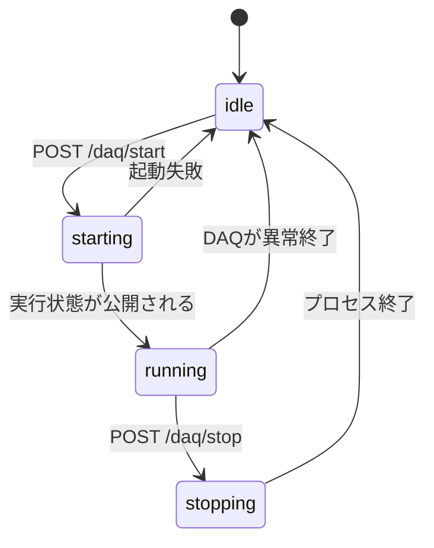

# DAQクライアント/サーバー間 HTTP API 契約 (v1)

サーバー(別PCのWebサーバー)とクライアント(DAQ PC)の間のインターフェースを定める。
両者の仕様書([クライアント](2026-11-12_2.md)、[サーバー](2026-11-12_3.md))はこの文書を参照する。
内容に食い違いがあればこの文書を正とする。

## 1. 用語と構成

| 用語 | 場所 | 役割 |
|---|---|---|
| クライアント (`daq-client`) | DAQ PC | 既存のDAQシステム(`mada.py`等)を持ち、HTTP APIでDAQの操作と状態の提供を行う |
| サーバー (`daq-server`) | 別PC | ブラウザ向けのWeb UIを提供し、クライアントのAPIを呼ぶ |

```
[ブラウザ] --HTTP(S)--> [サーバー] --HTTP--> [クライアント] --> mada.py / ファイル
                                  (サーバーが呼ぶ側、クライアントは待ち受け)
```

- 通信は常にサーバーからクライアントへ向かう(クライアントはサーバーへ接続しない)。
- クライアントが落ちてもDAQは止まらない(`mada.py -d` は独立したデーモン)。サーバーが落ちても同様。
- 管理対象のDAQは1台。複数台対応は本版の範囲外。
- 初期版はDAQのみ。スキャン、較正、config編集は含まない(後版で追加)。

## 2. 共通規約

- ベースURL: `http://<クライアントのホスト>:<port>/api/v1`(port の既定値は 8765)。
- 本体はJSON(UTF-8)。時刻はすべてクライアントのUNIX時刻 [s](浮動小数)。サイズは [byte]。
- 認証: `Authorization: Bearer <token>`。`GET /health` のみ不要。
- 成功時は 2xx。エラー時は次の形式で、HTTPステータスは 4xx/5xx。

```json
{ "error": { "code": "busy", "message": "mada_scan.py is running" } }
```

| HTTP | code | 意味 |
|---|---|---|
| 401 | `unauthorized` | トークンが無い/不正 |
| 403 | `forbidden_origin` | 許可されていない接続元 |
| 404 | `not_found` | run/period/file が存在しない |
| 409 | `busy` | DAQまたは他のMADAプログラムが動作中 |
| 409 | `not_running` | 停止要求だがDAQが動いていない |
| 409 | `busy_file_update` | 強制停止の要求だが、ファイルの準備中または終了処理中(ADALM制御中)で、今は安全に止められない。少し待って再要求する |
| 422 | `invalid_request` | パラメータが範囲外・形式不正 |
| 422 | `config_not_found` | runに `MADA_config.json` が無く、コピー元(`config_from`、 `latest_run`)も無い |
| 422 | `config_invalid` | `mada.py` の事前検査が失敗(`message` に検査出力) |
| 500 | `internal` | クライアント内部エラー |
| 503 | `start_failed` | 起動したがDAQが立ち上がらなかった |

- 操作系(POST)は非同期。受理したら 202 を返し、結果は `GET /status` の `phase` で確認する。
- 後方互換を壊す変更は `/api/v2` として別に提供する。互換を保つ追加(フィールド追加)は v1 のまま行い、
  サーバーは未知のフィールドを無視すること。

## 3. 状態モデル (`phase`)



| phase | 意味 |
|---|---|
| `idle` | DAQは動いていない |
| `starting` | `mada.py -d` を起動した。電源投入とDAC/Vth設定中で、ファイル取得はまだ始まっていない |
| `running` | ファイルを取得している(ファイル間の短い隙間を含む) |
| `stopping` | 停止要求を受け、後処理(DAQ enable下げ、電源OFF等)中。数十秒かかることがある |

`phase` が `idle` でも、他のMADAプログラム(スキャン、較正、`MadaIwaki`)が動いていれば `blocked_by` に
プログラム名が入り、`POST /daq/start` は 409 になる。

## 4. エンドポイント

### 4.1 `GET /health`
認証不要。クライアントの生存確認のみ。 `200 {"ok": true, "api_version": 1}`

### 4.2 `GET /status`
DAQの全体状態。サーバーは2秒周期での取得を想定。

```json
{
  "api_version": 1,
  "time": 1794455866.6,
  "phase": "running",
  "blocked_by": null,
  "latest_run": "20261112",
  "daq": {
    "pid": 12345,
    "run": "20261112",
    "period": 3,
    "file_id": 17,
    "valid_files": 17,
    "file_num": 512,
    "event_num": 1000,
    "sci": false,
    "started_at": 1794450000.0,
    "file_started_at": 1794455800.2,
    "stop_requested_at": null,
    "stop_mode": null,
    "boards": [ { "id": "GBKB-34", "ip": "192.168.100.97" } ]
  },
  "monitor": {
    "autoreset_running": true,
    "veto": { "failed": false, "asserted": false }
  },
  "last_exit": null
}
```

- `latest_run`: `perNNNN` を持つ直近のrun(更新時刻が最新)の名前。無ければ null。開始画面の `run` の既定に使う。
- `daq` は `phase` が `idle` のとき null。`starting` の間は `pid`、`run`、`file_num`、`event_num`、`sci` のみで、
  他は null。
- `stop_requested_at`: 停止要求を受けた時刻 [s]。 `stopping` が長引くときの判断材料(要求がなければ null)。
- `stop_mode`: 受け付けた停止の種類。 `"soft"`、 `"force"`、要求がなければ null。フィールドが無いクライアントは null と同じに扱う。
- `file_started_at`: DAQ enable を上げた時刻。ファイルの準備中(リーダー起動、カウンタリセット、DAQ enable 上げ)は null。
- `valid_files`: 現periodで有効に終わったファイル数(無効ファイルは数えない)。 `file_num` に達するとperiodが替わる。
- `monitor.autoreset_running`: LV過電流自動リセットのモニタの生存。DAQ動作中に false なら重大な異常として扱う。
- `monitor.veto`: `run/veto.state` の内容。 `failed` が true なら要対処。
- `last_exit`: 直近のDAQ終了の記録(4.8)。DAQが一度も走っていない、または動作中は null。

### 4.3 `POST /daq/start`
DAQを開始する。

```json
{ "run": "20261112", "file_num": 512, "event_num": 1000, "sci": false, "config_from": null }
```

| フィールド | 既定 | 条件 |
|---|---|---|
| `run` | `latest_run`(`/status`) | 出力先のrun名。 `^[A-Za-z0-9][A-Za-z0-9._-]{0,63}$`。クライアントの `data_root` 直下のディレクトリ名 |
| `config_from` | null | 新しいrunのconfigの引き継ぎ元のrun名。 `run` に `MADA_config.json` がすでにあるときは指定できない(422 `invalid_request`) |
| `file_num` | クライアント設定の既定値 | 1-10000 [files/period] |
| `event_num` | クライアント設定の既定値 | 1-100000 [events/file] |
| `sci` | false | true なら configの `SCI` セクションが有効であること |

- run は区切りの単位であり、日付とは限らない。 run は `data_root` 直下のディレクトリで、複数のperiod(`perNNNN`)を持つ。
  サーバーが `run` で指定する。
  - 既存のrunを指定すると、そのrunに続けて取得する(periodの番号は空き番号から続く)。
  - 存在しない名前を指定すると、新しいrunとして作成する。新しいrunの名前は、運用で決めた規則に従ってサーバーが与える
    (例: 開始日の `YYYYMMDD`)。クライアントは名前を自動では決めない。
- DAQのconfigは、そのrunディレクトリの `MADA_config.json` を使う(DAQ固有の値はここが持つ)。
  - runに `MADA_config.json` がある場合: それをそのまま使う。
  - 無い場合(新しいrun): `config_from` のrunのものをコピーする。 `config_from` が null なら、クライアント設定
    `carry_over_config` が true のとき `latest_run`(`MADA_config.json` を持つ直近のrun)のものをコピーする。
    コピー元が無ければ 422 `config_not_found`。
- 応答: `202 {"phase": "starting"}`。
- 失敗: 409 `busy`、422 `config_not_found` / `config_invalid` / `invalid_request`、503 `start_failed`。
- クライアントはconfigの内容を編集しない。コピーのみを行う。

### 4.4 `POST /daq/stop` / `POST /daq/stop/soft`
DAQを停止する。どちらも、Ctrl+C と同じ後処理(DAQ enable下げ、電源OFF等)が走る安全な停止である。
SIGKILL のような電源OFFを伴わない強制終了は提供しない。

| 種類 | パス | 動作 |
|---|---|---|
| force | `POST /daq/stop` | その時点で停止する(取得中のファイルは途中で終わる)。 SIGTERM を送る |
| soft | `POST /daq/stop/soft` | 取得中のファイルが完了してから停止する。 `mada.py` が各ファイルの終了後に要求を確認する |

- soft は別のパスにする。soft を知らない古いクライアントが、パラメータを無視して force として止めてしまわないため
  (古いクライアントは 404 を返す)。
- 応答: `202 {"phase": "stopping"}`(soft は `"mode": "soft"` も返す)。 `stopping` に入った時点で `daq.stop_mode` が入る。
  すでに `stopping` なら同じ応答(冪等)。
- 失敗: 409 `not_running`。
- force は、ファイルの取得中だけ受け付ける。ファイルの準備中(`daq.file_started_at` が null)と、ファイルの終了処理中
  (DAQ enable を下げてリーダーを止める間。進捗ファイルが消えている)は、ADALMを制御しており、割り込むとボードを
  不定な状態に置くため、409 `busy_file_update` で拒否する。クライアントがこの拒否の最終判断をする(サーバーは直前に
  `/status` と `/progress` を取り直して同じ確認を先に行うが、確認と送信の間に状態が変わりうる)。
- soft は、 `running` のときいつでも受け付ける(要求を残すだけで、ADALMは制御しない)。
- soft の待機中(`stopping`、 `stop_mode: "soft"`)に force を要求すると、force に切り替える(取得中のときのみ)。
- 手動で端末から起動された `mada.py` も停止できる。

### 4.5 `GET /progress`
動作中のファイルの進捗。サーバーは1秒周期での取得を想定。

```json
{
  "time": 1794455867.0,
  "stale": false,
  "file_id": 17,
  "event_num": 1000,
  "boards": { "GBKB-34": { "events": 420 }, "GBKB-35": { "events": 418 } },
  "lagging": []
}
```

- 取得中でない(`idle`、`starting`、`stopping`)ときは 200 で `boards` が空、`file_id` が null。
  ただし、soft 停止の待機中(`stopping` で `daq.stop_mode` が `"soft"`)は、取得中のファイルがまだ続いているので、
  `running` のときと同じ進捗を返す。
- `stale`: 進捗の更新が5秒以上止まっているとき true(DAQの異常の兆候)。
- `lagging`: 他のボードより遅れているボードID(`board_lag` の警告と同じ基準)。

### 4.6 `GET /runs`
`data_root` 直下のrunの一覧。 `perNNNN` を持つものだけ。更新時刻の新しい順。

```json
{ "runs": [ { "run": "20261112", "periods": [0, 1, 2, 3], "has_config": true, "modified": 1794455900.0 } ] }
```

- `has_config`: `MADA_config.json` があるか。 `modified`: 最後の更新 [s]。
- 新しいrunの名前が既存のものと重なっていないかの確認にも使う。

### 4.7 period / file / 警告 / ログ / config(読み取りのみ)

`GET /runs/{run}/periods/{period}/files?after=<file_id>&limit=<n>`
: period 内のファイル一覧(`.info` から構成)。 `after` を指定すると、それより大きい番号のみ。 `limit` 既定 100、最大 1000。

```json
{
  "files": [
    { "file_id": 17, "valid": true, "invalid_reason": null,
      "start": 1794455800.2, "end": 1794455830.9,
      "boards": { "GBKB-34": { "size": 1234567 } } }
  ]
}
```
実行中のファイルは `end` が null、 `size` が null。

`GET /runs/{run}/periods/{period}/warnings?after=<epoch>&limit=<n>`
: そのperiodの `warnings.log` の記録。 `after`(UNIX時刻)より新しいもの。 `limit` 既定 200、最大 2000。

```json
{
  "records": [
    { "t": 1794455801.123, "time": "2026-11-12T10:30:01.123", "file_id": 17,
      "source": "GBKB-35", "level": "WARNING", "kind": "board_lag",
      "message": "WARNING t=1794455801.123 kind=board_lag events=420 lead=422 sec=0.31" }
  ]
}
```
`level`、 `kind` はメッセージが `LEVEL t=... kind=...` の形式のときのみ(それ以外は null)。 `source` はボードID、 `DAQ`、 `LV`、 `SCI` 等。

`GET /log?offset=<byte>&max_bytes=<n>`
: 動作中(または直近)のDAQデーモンのログ(`$MADAHOME/run/<run>_<period>.log`)の追い読み。

```json
{ "file": "20261112_0003.log", "offset": 40960, "size": 40960, "text": "..." }
```
`offset` 省略時は末尾の8 KBを返す。応答の `offset` を次回の `offset` に渡す。 `file` が前回と違えば(periodが
替わった)、サーバーは `offset` を捨てて先頭から読む。 `max_bytes` 既定 65536。

`GET /runs/{run}/config`
: そのrunの `MADA_config.json` をそのまま返す(読み取りのみ。初期版では書き換えを提供しない)。
  新しいrunの開始前に、コピー元の内容を確認するのにも使う。

### 4.8 `last_exit`

DAQ終了時に `mada.py` が残す記録([クライアント仕様](2026-11-12_2.md) の「MADA本体の変更」)。

```json
{ "reason": "error", "message": "3 invalid files in a row; stopping",
  "time": 1794455900.0, "run": "20261112", "period": 3 }
```

| reason | 意味 |
|---|---|
| `stopped` | 停止要求(Ctrl+C、SIGTERM)による正常停止 |
| `error` | `MadaError` や予期しない例外による停止。 `message` に原因 |
| `crashed` | 終了記録なしにプロセスが消えた(SIGKILL、電源断等)。クライアントが推定 |

## 5. 排他

- DAQの開始は、`mada.py`、`mada_scan.py`、`mada_calib.py`、`MadaIwaki` のいずれかが動いていれば 409。
- クライアントは `start` の受付を直列化する(同時に2つの開始要求が来ても1つだけが実行される)。
- 端末から手動で起動されたDAQも `phase` に反映される(クライアント経由でなくても `running` になる)。

## 6. 推奨ポーリング(サーバー側)

| 対象 | 周期 | 備考 |
|---|---|---|
| `/status` | 2 s | 常時。連続3回失敗で「接続断」とする |
| `/progress` | 1 s | `phase` が `running` のときのみ |
| `/runs/.../warnings` | 5 s | 前回の最新 `t` を `after` に渡す |
| `/log` | 2 s | 画面でログを開いているときのみ |
| `/runs/.../files` | 10 s | 前回の最大 `file_id` を `after` に渡す |

接続断のとき、サーバーは `idle` と表示してはならない(状態不明として扱う)。

## 7. 変更履歴
- 2026-11-12: 初版。
- 2026-11-13: 停止を soft(`POST /daq/stop/soft`)と force(`POST /daq/stop`)に分けた。 force はファイルの準備中・終了処理中は 409 `busy_file_update`。 `daq.stop_mode` を追加(互換を保つ追加)。
